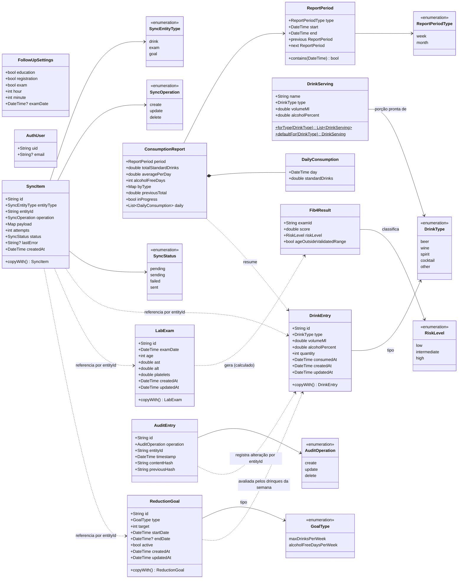
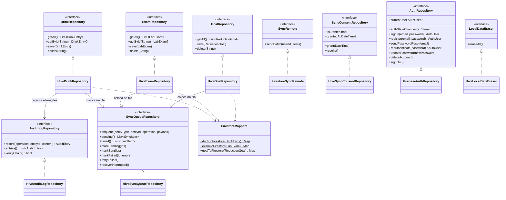
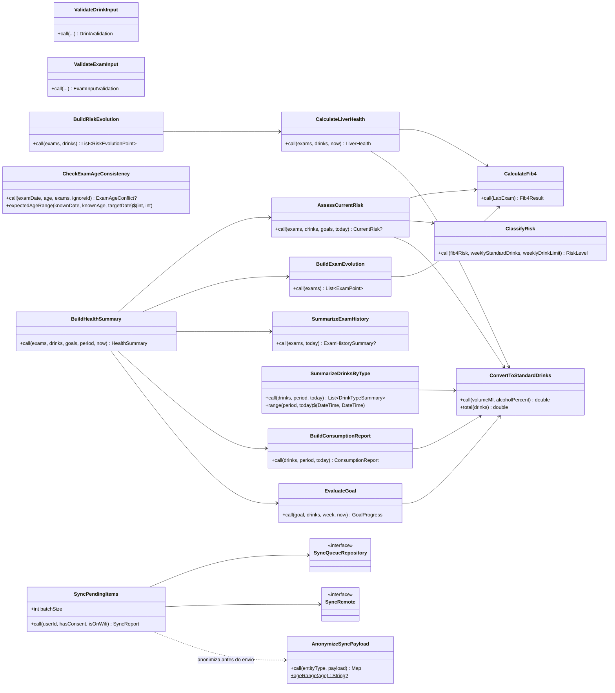
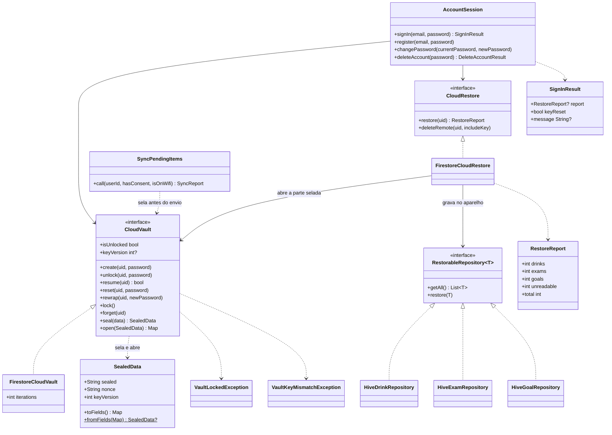

# Diagrama de Classes do HepatoCheck

Versão final do diagrama de classes da camada Domain do HepatoCheck (`hepatocheck_app/lib/domain/`) e das implementações da camada Data. A primeira versão, da semana 1, mostrava apenas as entidades; esta inclui as entidades criadas depois, os repositórios e os casos de uso.

As entidades são classes Dart imutáveis, sem dependência de Flutter, Hive ou Firebase. Alterações são feitas com `copyWith`, que devolve uma nova instância. Os casos de uso são classes com um único método `call`, e os repositórios do Domain são interfaces implementadas na camada Data.

O diagrama está dividido em quatro partes para continuar legível: entidades, repositórios, casos de uso, e cofre e restauração.

## 1. Entidades

## 2. Repositórios

Interfaces no Domain (`domain/repositories/`) e implementações na camada Data (`data/`).

## 3. Casos de uso

Casos de uso do Domain (`domain/usecases/`) e o que cada um usa.

## 4. Cofre e restauração

Classes que guardam a cópia na nuvem criptografada pela senha e trazem os dados de volta ao entrar na conta em outro aparelho (RF25).

- **`CloudVault`** (Domain) e **`FirestoreCloudVault`** (Data): uma chave de dados aleatória de 32 bytes criptografa a parte selada com AES-GCM 256. A chave fica no documento `users/{uid}` trancada por uma chave derivada da senha (PBKDF2-HMAC-SHA256) e, no aparelho, no armazenamento seguro. `reset` cria uma chave nova depois da recuperação de senha; `rewrap` tranca a mesma chave com uma senha nova; `forget` apaga a chave do aparelho.
- **`SealedData`**: os três campos da parte selada (`sealed`, `sealedNonce`, `keyVersion`).
- **`CloudRestore`** (Domain) e **`FirestoreCloudRestore`** (Data): baixa as três coleções, abre a parte selada e junta com o aparelho pela versão mais recente, sem desfazer o que está na fila. `deleteRemote` apaga a cópia da nuvem, lendo direto do servidor para falhar sem internet; com `includeKey`, apaga também o documento da chave `users/{uid}`.
- **`RestorableRepository`**: os repositórios Hive ganham `restore`, que grava sem colocar na fila e sem registro de alterações.
- **`SyncPendingItems`**: recebe `seal` e `sealReady`; com o cofre trancado, o envio espera (`SyncSkipReason.vaultLocked`).
- **`AccountSession`** (Presentation): junta login, abertura do cofre e restauração automática, e o cadastro com a criação do cofre. `changePassword` confirma a senha atual, tranca a chave com a senha nova (`rewrap`) e só então troca a senha; se o Firebase recusar, a chave volta para a senha atual. `deleteAccount` confirma a senha, apaga a nuvem com a chave, esquece a chave, apaga o aparelho e por fim a conta; com a senha errada ou sem internet, nada é apagado.

## Entidades

| Entidade | Responsabilidade | Relacionamentos |
| --- | --- | --- |
| `DrinkEntry` | Um registro do diário de álcool: tipo, volume, teor alcoólico, quantidade e momento do consumo | Tem um `DrinkType` |
| `DrinkServing` | Porções prontas de cada tipo de bebida (lata, taça, dose...), usadas no registro rápido | Tem um `DrinkType` |
| `LabExam` | Os dados de um exame laboratorial usados no FIB-4: idade, AST (TGO), ALT (TGP) e plaquetas | Gera um `Fib4Result` |
| `Fib4Result` | Resultado do FIB-4 de um exame. É calculado a partir do `LabExam` e não é editado nem armazenado separadamente | Pertence a um `LabExam` (por `examId`) e tem um `RiskLevel` |
| `ReductionGoal` | Meta de redução: máximo de drinques por semana ou dias sem álcool por semana | Tem um `GoalType` e é avaliada a partir dos `DrinkEntry` da semana |
| `ReportPeriod` | Semana (segunda a domingo) ou mês do relatório, com o período anterior e o seguinte | Tem um `ReportPeriodType` |
| `ConsumptionReport` | Resumo do consumo de um período: total, média por dia, dias sem álcool, consumo por tipo e por dia e comparação com o período anterior | Tem um `ReportPeriod` e vários `DailyConsumption` |
| `FollowUpSettings` | Preferências das notificações: mensagens educativas, lembrete de registro, lembrete de exame e horário | Usada pelas notificações locais |
| `AuthUser` | Usuário conectado: `uid` do Firebase e e-mail | Usado só para sincronizar |
| `SyncItem` | Item da fila offline de sincronização: o que mudou, a operação, o estado do envio e as tentativas | Referencia um `DrinkEntry`, `LabExam` ou `ReductionGoal` pelo `entityId` |
| `AuditEntry` | Registro de alteração do diário. Guarda só o hash do conteúdo e o hash da entrada anterior, nunca os dados do drinque | Referencia um `DrinkEntry` pelo `entityId` |

Os casos de uso também devolvem objetos de resultado que não são gravados: `CurrentRisk`, `LiverHealth`, `RiskEvolutionPoint`, `ExamPoint`, `ExamHistorySummary`, `GoalProgress` (com `GoalStatus`), `HealthSummary`, `FollowUpMessage`, `SyncReport`, `ExamAgeConflict` (aviso de idade incoerente entre exames) e `DrinkTypeSummary` (consumo de um tipo de bebida em drinques padrão na semana, no mês ou no ano).

## Mudanças em relação à primeira versão

- **Entidades novas:** `DrinkServing`, `ReportPeriod`, `ConsumptionReport`, `DailyConsumption`, `FollowUpSettings` e `AuthUser`.
- **Repositórios e casos de uso:** passaram a fazer parte do diagrama (seções 2 e 3).
- **Cofre e restauração:** seção 4, com as classes da restauração dos dados em outro aparelho (RF25).
- **`UserPreferences` saiu do diagrama:** no rascunho, uma única entidade guardava camuflagem, consentimento e lembretes. Na implementação, cada preferência ficou com o componente responsável: o Modo Camuflagem usa o armazenamento seguro (`CamouflagePreferencesStore`), o consentimento tem o seu repositório (`SyncConsentRepository`) e os lembretes usam `FollowUpSettings`. A classe ainda existe em `domain/entities/user_preferences.dart`, mas não é usada.

## Persistência local

`DrinkEntry`, `LabExam`, `SyncItem` e `AuditEntry` têm adaptadores do Hive gerados (`lib/data/models/hive_adapters.dart`). Metas e preferências de notificação são gravadas como texto JSON, e o consentimento guarda apenas a data em que foi dado. Todas as caixas são criptografadas com AES-256, e a chave é criada no primeiro uso e fica no armazenamento seguro do aparelho (`lib/core/crypto/encryption_key_provider.dart`).

O Hive criptografa os valores, mas não as chaves de cada registro. Por isso, os registros são gravados usando o `id` (UUID aleatório) como chave, sem nenhuma informação sensível.

A conversão das entidades para os documentos do Firestore, a parte selada e a restauração estão em [`modelagem-firestore.md`](modelagem-firestore.md).
