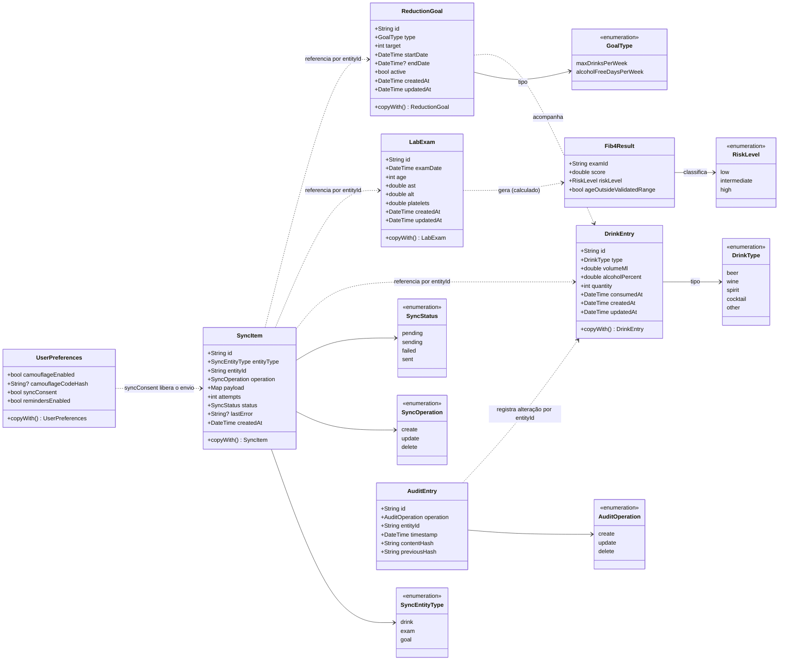

# Diagrama de Classes — Modelos de Domínio

Rascunho das entidades da camada Domain do HepatoCheck (`hepatocheck_app/lib/domain/entities/`). As entidades são classes Dart imutáveis, sem dependência de Flutter, Hive ou Firebase. Alterações são feitas com `copyWith`, que devolve uma nova instância.

Este rascunho será completado ao longo das sprints com os casos de uso e os repositórios.

## Entidades

| Entidade | Responsabilidade | Relacionamentos |
| --- | --- | --- |
| `DrinkEntry` | Um registro do diário de álcool: tipo, volume, teor alcoólico, quantidade e momento do consumo | Tem um `DrinkType` |
| `LabExam` | Os dados de um exame laboratorial usados no FIB-4: idade, AST (TGO), ALT (TGP) e plaquetas | Gera um `Fib4Result` |
| `Fib4Result` | Resultado do FIB-4 de um exame. É calculado a partir do `LabExam` e não é editado nem armazenado separadamente (CRUD de exames em `requisitos.md`) | Pertence a um `LabExam` (por `examId`) e tem um `RiskLevel` |
| `ReductionGoal` | Meta de redução: máximo de drinques por semana ou dias sem álcool por semana | Tem um `GoalType` e é avaliada a partir dos `DrinkEntry` do período |
| `UserPreferences` | Preferências locais: Modo Camuflagem (com o código guardado só como hash), consentimento de sincronização e lembretes | O consentimento libera o envio dos `SyncItem` |
| `SyncItem` | Item da fila offline de sincronização: o que mudou, a operação, o estado do envio e as tentativas | Referencia um `DrinkEntry`, `LabExam` ou `ReductionGoal` pelo `entityId` |
| `AuditEntry` | Registro de alteração do diário. Guarda só o hash do conteúdo e o hash da entrada anterior, nunca os dados do drinque | Referencia um `DrinkEntry` pelo `entityId` |

## Persistência local

`DrinkEntry`, `DrinkType` e `LabExam` já têm adaptadores do Hive gerados (`lib/data/models/hive_adapters.dart`) e são gravados em caixas criptografadas com AES-256. A chave é criada no primeiro uso e fica no armazenamento seguro do aparelho (`lib/core/crypto/encryption_key_provider.dart`).

O Hive criptografa os valores, mas não as chaves de cada registro. Por isso, os registros devem ser gravados usando o `id` (UUID aleatório) como chave, sem nenhuma informação sensível.
