# EAP Simplificada — Estrutura Analítica do Projeto

A EAP divide o HepatoCheck nas entregas que precisam existir para o projeto ser concluído. Ela parte do `escopo.md`, que define o que está dentro do projeto, e cada entrega aparece no `sprints.md`, que define quando ela é feita.

Esta versão simplificada tem três níveis: o projeto, as grandes entregas e os pacotes de trabalho.

## Estrutura

```mermaid
flowchart LR
    P["HepatoCheck"]

    P --> E1["1. Gestão do projeto"]
    P --> E2["2. Fundação técnica"]
    P --> E3["3. Núcleo clínico"]
    P --> E4["4. Diário de álcool"]
    P --> E5["5. Privacidade"]
    P --> E6["6. Nuvem"]
    P --> E7["7. Acompanhamento"]
    P --> E8["8. Documentação técnica"]
    P --> E9["9. Qualidade e entrega"]

    E1 --> E1a["1.1 Escopo"]
    E1 --> E1b["1.2 EAP"]
    E1 --> E1c["1.3 Planejamento em sprints"]
    E1 --> E1d["1.4 README, CHANGELOG e checkpoints"]

    E2 --> E2a["2.1 Arquitetura em camadas e Riverpod"]
    E2 --> E2b["2.2 Tema e tipografia"]
    E2 --> E2c["2.3 Navegação com 5 abas"]
    E2 --> E2d["2.4 Banco local Hive criptografado"]

    E3 --> E3a["3.1 Cálculo e validação do FIB-4"]
    E3 --> E3b["3.2 Classificação de risco"]
    E3 --> E3c["3.3 Exames: cadastro, histórico e tela"]
    E3 --> E3d["3.4 Tela Início e medidor do fígado"]
    E3 --> E3e["3.5 Orientação sobre quando procurar o médico"]

    E4 --> E4a["4.1 Registro por tipo de bebida e drinque padrão"]
    E4 --> E4b["4.2 Registro rápido em 3 toques"]
    E4 --> E4c["4.3 Registro de alterações do diário"]
    E4 --> E4d["4.4 Metas de redução"]

    E5 --> E5a["5.1 Modo Camuflagem"]
    E5 --> E5b["5.2 Criptografia ao ativar a camuflagem"]

    E6 --> E6a["6.1 Login opcional e modo convidado"]
    E6 --> E6b["6.2 Consentimento de sincronização"]
    E6 --> E6c["6.3 Fila offline e detecção de Wi-Fi"]
    E6 --> E6d["6.4 Anonimização dos dados"]
    E6 --> E6e["6.5 Sincronização em lote e falhas parciais"]

    E7 --> E7a["7.1 Relatórios semanais e mensais"]
    E7 --> E7b["7.2 Evolução do risco e dashboard de exames"]
    E7 --> E7c["7.3 Notificações e lembretes"]
    E7 --> E7d["7.4 Modo consulta"]
    E7 --> E7e["7.5 Exportação em PDF"]

    E8 --> E8a["8.1 Diagrama de casos de uso"]
    E8 --> E8b["8.2 Diagrama de classes"]
    E8 --> E8c["8.3 Modelagem do Firestore"]
    E8 --> E8d["8.4 Fluxo de navegação real"]
    E8 --> E8e["8.5 Protótipos atualizados"]
    E8 --> E8f["8.6 Registro de uso de IA"]

    E9 --> E9a["9.1 Testes automatizados"]
    E9 --> E9b["9.2 Testes em Android 8.0 ou superior"]
    E9 --> E9c["9.3 APK"]
    E9 --> E9d["9.4 Apresentação e vídeo"]
```

## Dicionário da EAP

| Código | Entrega | Descrição | Sprint |
| --- | --- | --- | --- |
| **1** | **Gestão do projeto** | Documentos que planejam e acompanham o trabalho | 1 a 4 |
| 1.1 | Escopo | O que está dentro e fora do projeto, restrições e premissas | 1 |
| 1.2 | EAP | Este documento | 1 |
| 1.3 | Planejamento em sprints | As 4 sprints com objetivo, entrega e responsáveis | 1 |
| 1.4 | README, CHANGELOG e checkpoints | Responsabilidades e entregas atualizadas ao fim de cada sprint | 1 a 4 |
| **2** | **Fundação técnica** | Base sobre a qual todas as funcionalidades são construídas | 1 |
| 2.1 | Arquitetura em camadas e Riverpod | Pastas Presentation, Domain e Data e estado gerenciado pelo Riverpod | 1 |
| 2.2 | Tema e tipografia | Tema escuro em verde oliva, cores do semáforo e fonte Inter | 1 |
| 2.3 | Navegação com 5 abas | Início, Relatório, Drinks, Exames e Perfil | 1 |
| 2.4 | Banco local Hive criptografado | Entidades do domínio, caixas com AES-256 e chave no armazenamento seguro do aparelho | 1 |
| **3** | **Núcleo clínico** | Cálculo e apresentação do risco hepático | 1 a 4 |
| 3.1 | Cálculo e validação do FIB-4 | Fórmula, recusa de entradas inconsistentes e aviso de idade fora de 35 a 65 anos | 1 |
| 3.2 | Classificação de risco | Verde, Amarelo e Vermelho a partir do FIB-4 e do consumo | 1 |
| 3.3 | Exames: cadastro, histórico e tela | CRUD de exames com recálculo automático do FIB-4 | 1 e 2 |
| 3.4 | Tela Início e medidor do fígado | Cartão de risco e medidor de 0 a 100% com a cor do risco | 1 e 2 |
| 3.5 | Orientação sobre quando procurar o médico | O que cada faixa de risco significa e quando buscar um profissional | 4 |
| **4** | **Diário de álcool** | Registro e controle do consumo | 2 e 3 |
| 4.1 | Registro por tipo de bebida e drinque padrão | Tipo, volume e teor alcoólico, com a conversão mostrada antes de confirmar | 2 |
| 4.2 | Registro rápido em 3 toques | Atalho a partir do botão + da tela Início | 2 |
| 4.3 | Registro de alterações do diário | Log de alterações que guarda só hashes, sem expor o conteúdo | 2 |
| 4.4 | Metas de redução | Metas de drinques por semana ou dias sem álcool, com feedback | 3 |
| **5** | **Privacidade** | Proteção dos dados sensíveis no aparelho | 1 e 2 |
| 5.1 | Modo Camuflagem | Calculadora funcional que esconde o diário, com troca instantânea e código secreto | 1 e 2 |
| 5.2 | Criptografia ao ativar a camuflagem | Migração das demais caixas para caixas criptografadas | 2 |
| **6** | **Nuvem** | Uso opcional do Firebase, com privacidade | 2 e 3 |
| 6.1 | Login opcional e modo convidado | Firebase Authentication por e-mail e senha, sem obrigar o cadastro | 2 e 3 |
| 6.2 | Consentimento de sincronização | Autorização explícita e revogável do usuário | 3 |
| 6.3 | Fila offline e detecção de Wi-Fi | Alterações guardadas no aparelho e enviadas só por Wi-Fi | 2 |
| 6.4 | Anonimização dos dados | Remoção ou generalização dos dados identificáveis antes do envio | 3 |
| 6.5 | Sincronização em lote e falhas parciais | Envio em lotes para o Cloud Firestore, com novas tentativas e isolamento dos registros com erro | 3 |
| **7** | **Acompanhamento** | Visualização da evolução e apoio à consulta | 2 a 4 |
| 7.1 | Relatórios semanais e mensais | Consumo em drinques padrão, dias sem álcool e consumo por tipo de bebida | 2 e 3 |
| 7.2 | Evolução do risco e dashboard de exames | Gráficos do FIB-4, do medidor e dos exames ao longo do tempo | 3 |
| 7.3 | Notificações e lembretes | Mensagens educativas personalizadas e lembretes de exame e de registro | 3 |
| 7.4 | Modo consulta | Resumo dos principais indicadores para o profissional de saúde | 4 |
| 7.5 | Exportação em PDF | Resumo com FIB-4, consumo, metas e classificação de risco | 3 |
| **8** | **Documentação técnica** | Artefatos exigidos para a avaliação | 1 a 4 |
| 8.1 | Diagrama de casos de uso | Casos de uso com as regras da Unidade II | 1 |
| 8.2 | Diagrama de classes | Entidades do domínio com atributos, métodos e relacionamentos | 1 e 4 |
| 8.3 | Modelagem do Firestore | Coleções e documentos e o mapeamento das classes Dart | 3 |
| 8.4 | Fluxo de navegação real | Como as telas do app pronto se conectam | 4 |
| 8.5 | Protótipos atualizados | Protótipos de baixa e alta fidelidade com as telas da Unidade II | 2 |
| 8.6 | Registro de uso de IA | Prompts, erros da IA, soluções e justificativa das bibliotecas | 4 |
| **9** | **Qualidade e entrega** | Verificação e entrega final | 1 a 4 |
| 9.1 | Testes automatizados | Testes do FIB-4, da validação, da criptografia, da sincronização e da anonimização | 1 a 3 |
| 9.2 | Testes em Android 8.0 ou superior | Execução do app em aparelho ou emulador | 4 |
| 9.3 | APK | Versão instalável do app | 4 |
| 9.4 | Apresentação e vídeo | Slides e vídeo de demonstração | 4 |
