# Fluxo de navegação real — HepatoCheck (A9)

Revisão de 18/11/2026, sobre a `main` no commit `4ad37eb` e as correções desta branch. Este documento descreve as telas implementadas, não o protótipo. A entrega solicitada é apenas documental; não inclui slides.

## Entrada e abas

O app inicia no modo convidado, na aba **Início**. Se a camuflagem estiver ativa, a calculadora aparece antes das abas. Login é opcional; sincronização exige conta, consentimento e Wi-Fi.

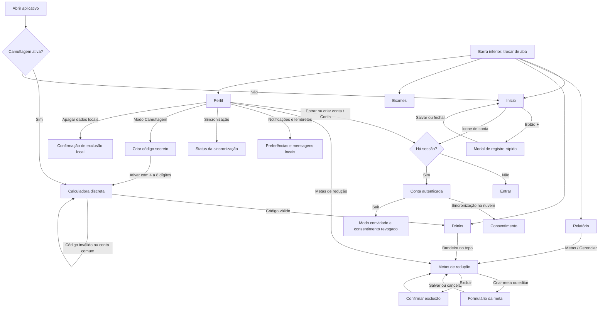

As abas usam índices 0 (Início), 1 (Relatório), 2 (Drinks), 3 (Exames) e 4 (Perfil). Trocar de aba substitui o conteúdo do shell. Telas de metas, preferências, conta e sincronização são rotas empilhadas; o botão Voltar retorna à origem.

## Autenticação e privacidade

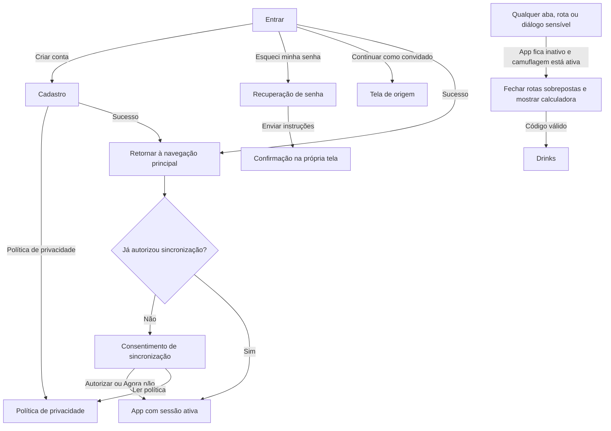

Ao bloquear, rotas abertas (como Metas) e diálogos são fechados para a raiz. Ao desbloquear, o app volta a Drinks, sem reabrir a tela sensível anterior. A proteção de prévia no alternador de aplicativos usa o canal nativo Android. A calculadora não mostra nome, logo ou ícone do HepatoCheck.

## Ações dentro de cada tela

| Origem | Ação e destino real |
| --- | --- |
| Início | Exibe medidor, resumo do consumo e evolução do risco; `+` abre registro rápido. |
| Drinks | Formulário e histórico na própria aba; editar preenche o formulário; excluir abre confirmação; seletores de data/hora abrem diálogos. |
| Exames | Cadastro/cálculo e histórico na própria aba; editar preenche o formulário; excluir pede confirmação; data abre calendário. |
| Relatório | Semana/mês e anterior/próximo atualizam a própria tela; evolução e gráficos ficam nela; Gerenciar abre Metas. |
| Relatório → PDF | O cartão de exportação pede confirmação e abre a impressão/compartilhamento nativo; não existe uma aba PDF. |
| Metas | Lista de metas → criar/editar → formulário → salvar/cancelar → lista. Máximo de drinques: 0–100 por semana; dias sem consumo: 1–7. |
| Notificações | Preferências, horário, lembretes de exame e mensagens na mesma tela. A permissão e o agendamento fora do app são serviços nativos. |
| Perfil | Conta, metas, notificações, camuflagem, sincronização e exclusão local. |
| Sincronização | Contadores de pendências/falhas e envio manual. A tela não representa autorização automática de envio. |

## Capturas das telas implementadas

As imagens abaixo foram produzidas pelo teste `test/presentation/navigation_evidence_test.dart`, navegando pelo `AppNavigationShell` real e seus botões. São renderizações Flutter em viewport **390 × 844**, com PNG em escala 2, fonte Inter e Material Icons. Os repositórios são substituídos por dados fictícios em memória; o armazenamento das preferências é temporário e a proteção nativa é simulada. Não são fotografias de um aparelho Android, nem prova de entrega de notificações, login real no Firebase ou sincronização em produção. Barras do sistema e teclado nativo não fazem parte das capturas.

### Início, registro rápido e relatório

| Início | Registro rápido | Relatório |
| --- | --- | --- |
| 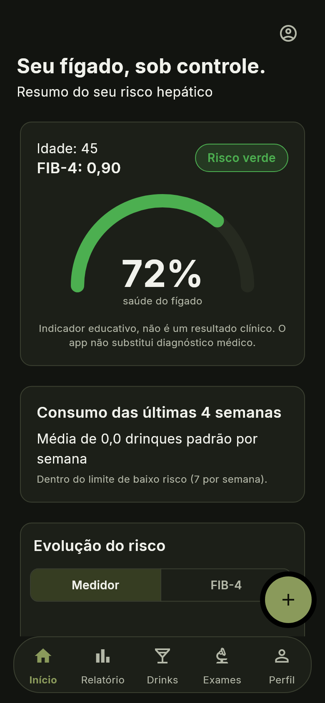 | 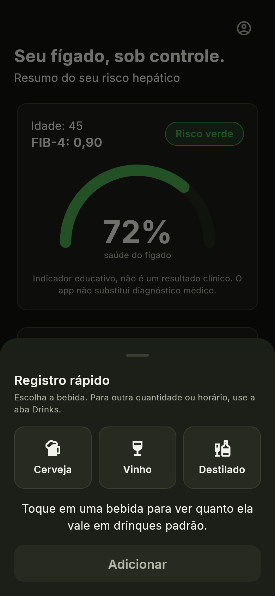 | 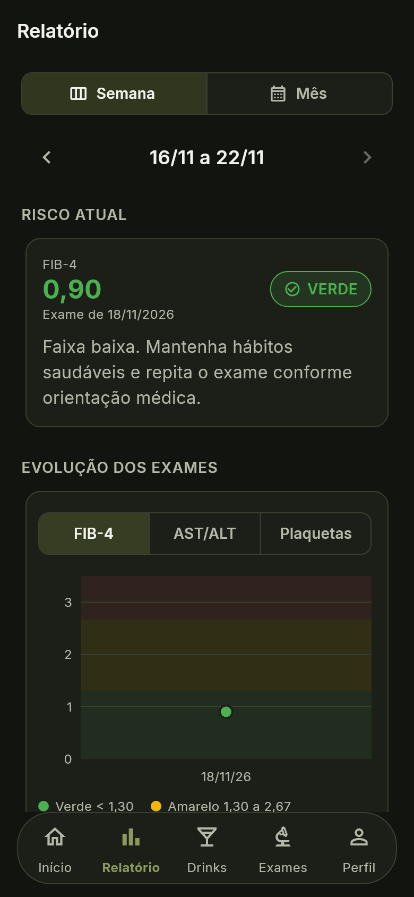 |

### Drinks e metas

| Drinks | Metas | Criar meta |
| --- | --- | --- |
| 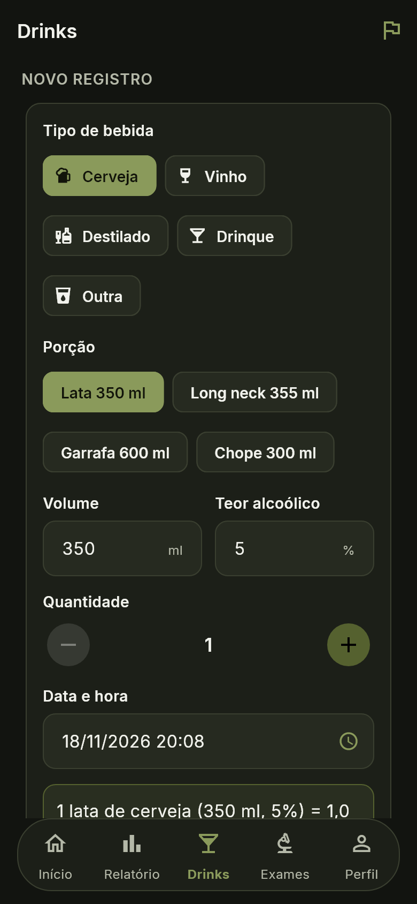 | 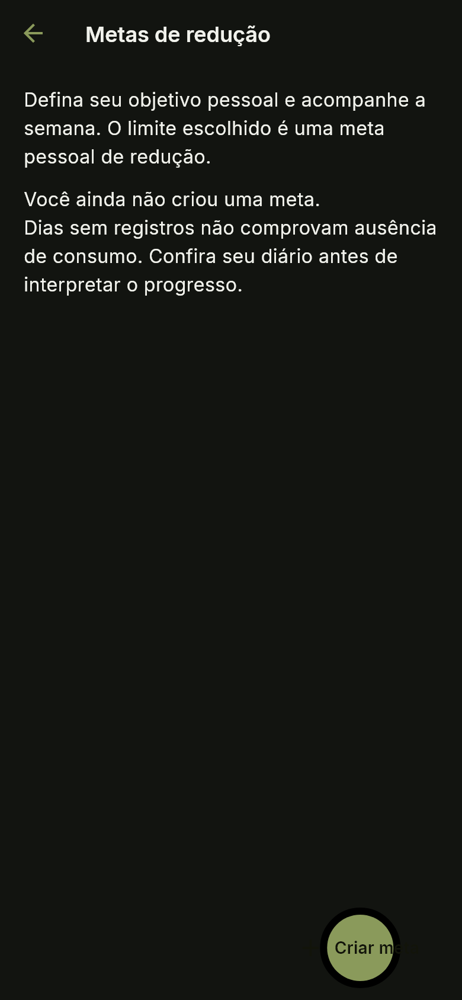 | 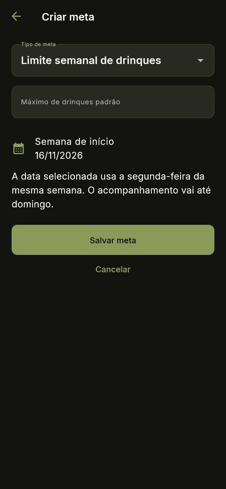 |

### Exames e preferências

| Exames | Perfil | Notificações e lembretes |
| --- | --- | --- |
| 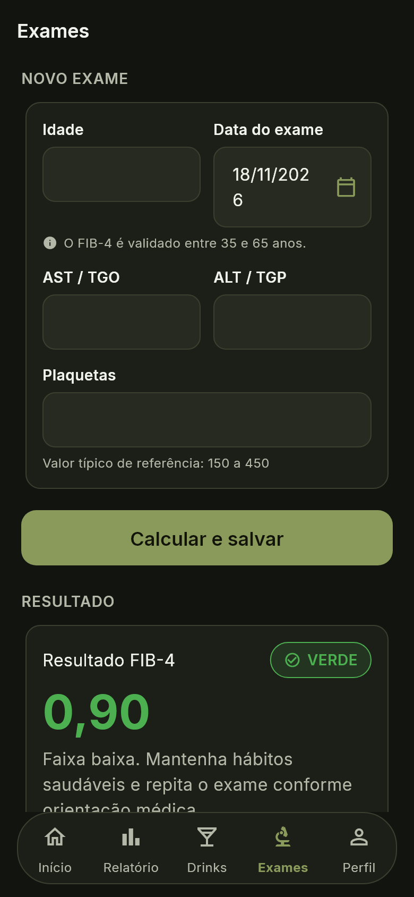 | 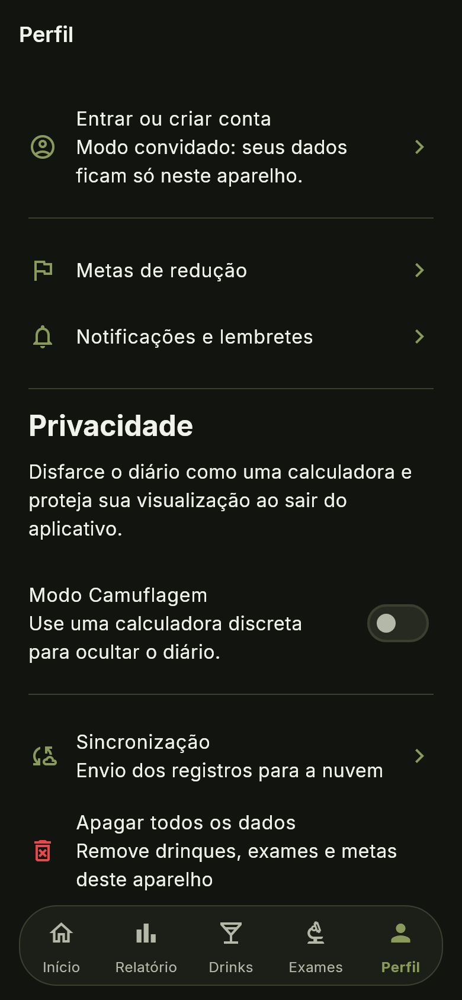 | 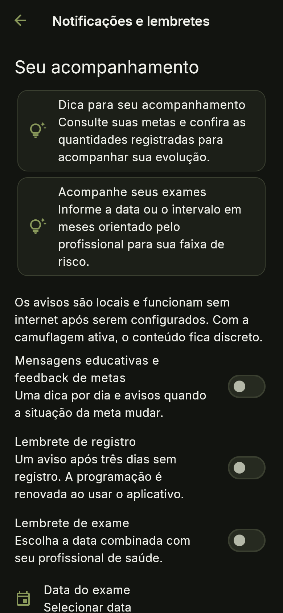 |

### Acesso opcional à conta

| Entrar | Cadastro | Recuperar senha |
| --- | --- | --- |
| 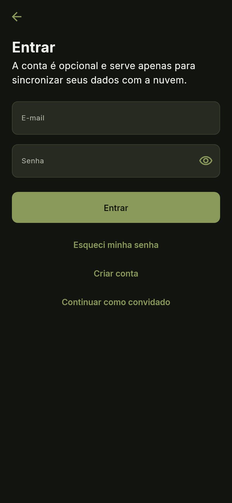 | 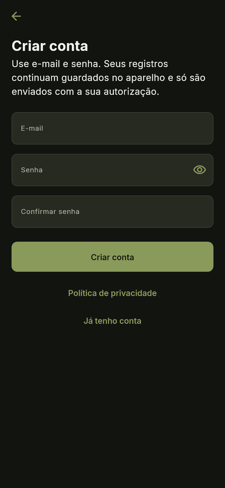 | 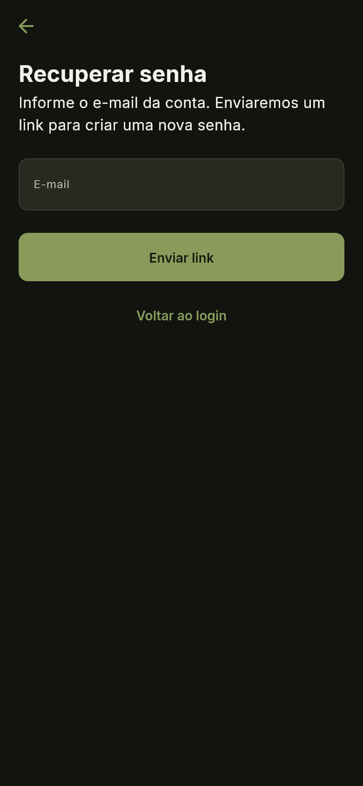 |

### Sincronização, filtro visual e camuflagem

| Sincronização | Risco alto | Calculadora discreta |
| --- | --- | --- |
| 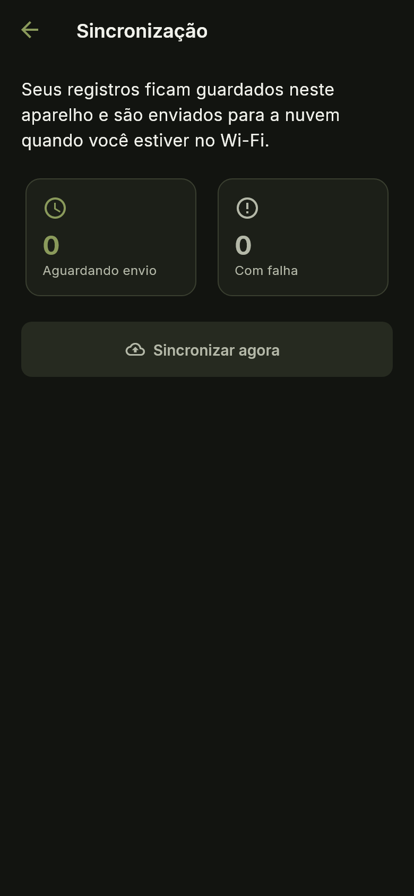 | 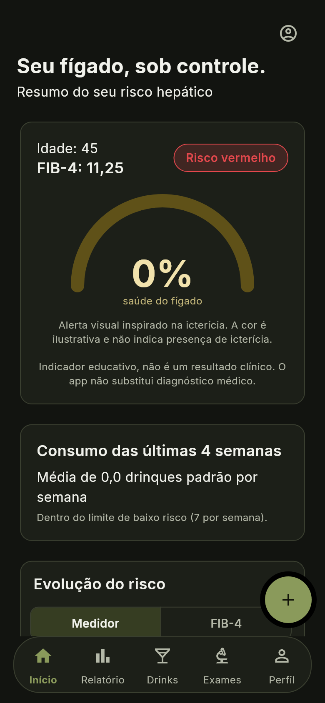 | 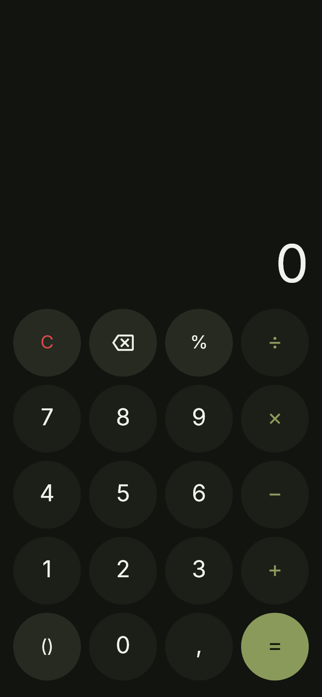 |

O filtro inspirado na icterícia aparece **somente no medidor quando `health.risk == RiskLevel.high`**. O selo de classificação continua vermelho; a interface de leitura e a calculadora não recebem o filtro. A explicação na tela distingue o efeito ilustrativo da presença real de icterícia. A classificação e o cálculo do FIB-4 não foram alterados.

## Correções e evidências da revisão (tarefa 56)

| Área | Verificação ou correção | Evidência automatizada |
| --- | --- | --- |
| Camuflagem | Corrigido bloqueio com rota sensível aberta; rotas são fechadas antes de mostrar a calculadora. Código válido retorna a Drinks. | `navigation_evidence_test.dart` simula inatividade com Metas aberta e confere bloqueio/desbloqueio. |
| Calculadora | Corrigida porcentagem relativa dentro de grupo ainda aberto; preservadas precedência, multiplicação implícita e parênteses automáticos. | `calculator_engine_test.dart`, incluindo `2 × (200 + 10%) = 440`. |
| Metas | Conferidos limites 0–100 drinques e 1–7 dias, validação do formulário, persistência e integração com fila de sincronização da main atual. | `goals_screen_test.dart`, `hive_goal_repository_test.dart` e testes de avaliação das metas. |
| Notificações | Conferidos conteúdo discreto com camuflagem, cancelamento quando desligadas, permissão negada, horário local e feedback emitido uma vez por situação. | `local_follow_up_notifications_test.dart` usa canais nativos simulados e relógio fixo para não depender da data de execução; `follow_up_screen_test.dart` cobre preferências. |
| Risco alto | Filtro ilustrativo amarelo restrito ao medidor, com selo de risco vermelho preservado. Sem filtro nas demais faixas ou sem exame. | `risk_card_filter_test.dart` e captura 14. |

### Resultado da validação

Em 18/11/2026, `flutter analyze` terminou sem problemas e `flutter test` aprovou **325 testes**. A geração das capturas também passou pelos testes de navegação. A execução em aparelho Android permanece uma etapa de aceitação manual.

### Reproduzir as verificações

Na raiz do repositório:

```powershell
cd hepatocheck_app
flutter analyze
flutter test
flutter test test/presentation/navigation_evidence_test.dart --dart-define=CAPTURE_NAVIGATION=true
```

O último comando regenera os 15 PNGs em `docs/imagens/navegacao/`. Sem a opção `CAPTURE_NAVIGATION`, os testes verificam a navegação sem regravar as imagens.

### Congelamento em 23/11/2026

Conforme a Sprint 4 de [sprints.md](sprints.md), a partir de **23/11/2026 não entram novas funcionalidades**. A revisão e a implementação deste filtro previsto nos requisitos são preparadas antes dessa data. De 23 a 27/11, aceitar somente correções, testes, documentação e preparação da entrega. Novas ideias ficam para uma versão posterior.

Antes da entrega, ainda é necessário validar em aparelho Android: retorno do segundo plano e prévia de aplicativos recentes, fonte do sistema ampliada, permissão e entrega dos lembretes, login/sincronização reais com consentimento e geração/compartilhamento do PDF. Os testes de widgets e canais simulados não substituem essa conferência.

## Fontes no repositório

- [Navegação principal e Perfil](../hepatocheck_app/lib/app.dart)
- [Fluxo após autenticação](../hepatocheck_app/lib/presentation/screens/auth/auth_flow.dart)
- [Metas](../hepatocheck_app/lib/presentation/screens/goals_screen.dart)
- [Notificações locais](../hepatocheck_app/lib/data/notifications/local_follow_up_notifications.dart)
- [Relatório](../hepatocheck_app/lib/presentation/screens/report_screen.dart)
- [Cartão de risco e filtro](../hepatocheck_app/lib/presentation/widgets/risk_card.dart)
- [Teste e gerador das capturas](../hepatocheck_app/test/presentation/navigation_evidence_test.dart)
