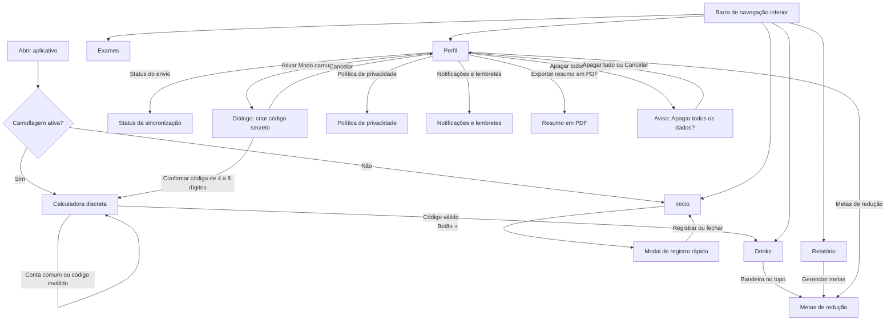
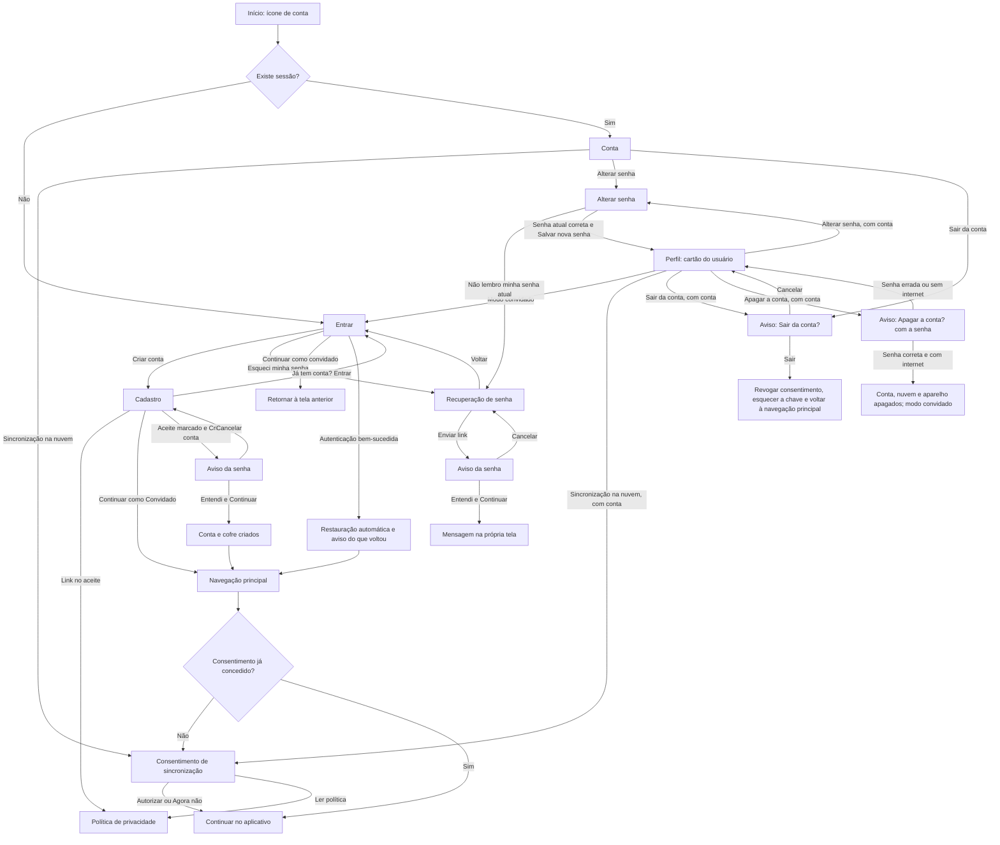
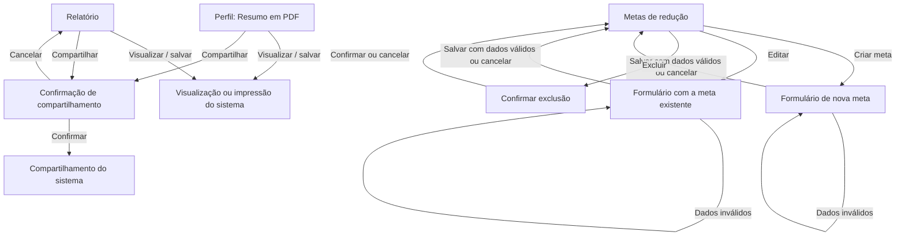

# Fluxo de navegação real — HepatoCheck (A9)

Este documento descreve a navegação implementada no código do aplicativo. A revisão foi feita pela leitura das rotas e ações das telas; não representa uma validação em aparelho. As capturas de tela serão incluídas posteriormente.

## 1. Entrada e navegação principal

O aplicativo inicia na aba **Início**, sem exigir login. Se o Modo Camuflagem estiver ativo, a navegação principal é substituída pela calculadora. O código secreto válido abre a aba **Drinks**.

Na primeira abertura do Início, uma animação curta (cerca de 2 segundos) mostra a silhueta do corpo, a linha do "scan" e o fígado acendendo na cor do risco antes de o cartão aparecer. Ela não se repete ao voltar para a aba, é pulada com um toque na tela e não roda quando o Android está com "remover animações".

O Perfil é organizado em cartões por assunto, nesta ordem: cartão do usuário; **Privacidade e sincronização** (Sincronização na nuvem, só com conta; Status do envio; Modo camuflagem; Política de privacidade); **Acompanhamento** (Metas de redução; Notificações e lembretes); **Relatório** (Exportar resumo em PDF); **Conta**, só com conta (Alterar senha; Sair da conta; Apagar a conta); e, separado no fim, **Apagar todos os dados**.

A barra inferior troca o conteúdo da tela principal. Seus índices são: **0 — Início; 1 — Relatório; 2 — Drinks; 3 — Exames; 4 — Perfil**. Metas, notificações e sincronização são abertas sobre a tela de origem com `Navigator.push`; o botão Voltar retorna à tela anterior.

## 2. Conta, autenticação e consentimento

O ícone de conta do Início abre **Entrar**, no modo convidado, ou **Conta**, quando já existe sessão. No Perfil, o cartão do usuário abre **Entrar** só no modo convidado; com a conta conectada ele apenas mostra o e-mail, porque sincronização, alterar senha, sair e apagar a conta já estão no próprio Perfil. No cadastro, o botão **Criar conta** só fica ativo depois de marcar "Li e aceito a Política de Privacidade". Antes de criar a conta e antes de enviar o e-mail de recuperação de senha, aparece o aviso **"Seus dados ficam trancados com a sua senha"**, que só deixa continuar depois de marcar "Entendi". Após o login, o app restaura automaticamente os dados da conta e mostra quanto foi restaurado. Após login ou cadastro bem-sucedido, o app fecha as rotas até a navegação principal e solicita consentimento se ele ainda não foi concedido.

Recusar o consentimento mantém o uso local. Autorizar o envio não troca de aba: fecha a tela de consentimento. Ao sair da conta, depois de confirmar no aviso, o app revoga o consentimento e preserva os dados locais. Alterar senha confirma a senha atual, tranca a chave da nuvem com a senha nova e só então troca a senha. Apagar a conta pede a senha e, com a senha errada ou sem internet, não apaga nada. "Apagar todos os dados", com conta, apaga também a cópia da nuvem; sem internet, nada é apagado. A política de privacidade é uma rota de leitura que retorna à sua origem pelo botão Voltar.

## 3. Metas, formulários e ações internas

| Tela | Ações dentro da tela e destinos |
| --- | --- |
| Início | Corpo ao fundo com o fígado na cor do risco, cartão com o medidor, resumo do consumo e evolução do risco. O botão `+` abre o modal de registro rápido; salvar fecha o modal e mostra a confirmação. |
| Drinks | Registro, consumo por tipo (Semana, Mês ou Ano, em drinques padrão) e histórico ficam na própria aba. Editar preenche o formulário; excluir abre confirmação. Data e hora usam seletores em diálogos. |
| Exames | Formulário, cálculo, resultado e histórico ficam na própria aba. Editar preenche o formulário; excluir abre confirmação; a data abre um calendário. Se a idade não combinar com a de outro exame, o aviso "Confira a idade" oferece Corrigir ou Salvar assim mesmo. |
| Relatório | Semana/mês e anterior/próximo atualizam a mesma tela. Gráficos, resumo do consumo, evolução dos exames e progresso das metas não são rotas separadas. |
| Metas de redução | Criar e editar abrem `GoalFormScreen`. Salvar retorna à lista; dados inválidos mantêm o formulário aberto. Excluir pede confirmação. |
| Notificações e lembretes | Preferências, mensagens e salvamento ficam na mesma tela. Data do exame e horário abrem seletores. A permissão de notificações depende do sistema operacional. |
| Sincronização | Contadores de pendências/falhas e resultado do envio ficam na mesma tela. O envio depende das condições de autenticação, consentimento e conexão. |
| Perfil | Cartões por assunto: usuário, privacidade e sincronização, acompanhamento, relatório, conta e apagar todos os dados. Sair, apagar a conta e apagar os dados pedem confirmação. |
| Alterar senha | Senha atual, nova senha e confirmação, com a lista do que a nova senha precisa ter. "Não lembro minha senha atual" abre a recuperação. Ao salvar, volta para a tela anterior. |
| PDF | A visualização e o compartilhamento usam a interface do sistema; não existe uma aba PDF. O resumo abre pelo Relatório ou pelo atalho do Perfil. Apenas o compartilhamento pede confirmação prévia no aplicativo. |

## 4. Camuflagem e retorno ao aplicativo

- Ativar o Modo Camuflagem no Perfil abre o diálogo de criação do código secreto. Após a confirmação, o shell passa a mostrar a calculadora.
- Digitar um código válido na calculadora desbloqueia o diário e seleciona Drinks (índice 2).
- Com a camuflagem ativa, os estados de ciclo de vida `inactive`, `paused` e `hidden` solicitam o bloqueio; a calculadora substitui o conteúdo do shell.
- Desativar a opção no Perfil desliga a camuflagem.

**Observação sobre o código atual:** `_lockForPrivacy` bloqueia o controlador, mas não remove explicitamente as rotas ou diálogos empilhados sobre o shell. Por isso, o bloqueio com uma tela como Metas aberta precisa de verificação específica; este documento não afirma que essas rotas sejam fechadas automaticamente. Nenhuma alteração no comportamento do aplicativo foi feita nesta tarefa documental.

## 5. Fontes consultadas

- [Navegação principal](../hepatocheck_app/lib/app.dart)
- [Perfil e Resumo em PDF](../hepatocheck_app/lib/presentation/screens/profile_screen.dart)
- [Início](../hepatocheck_app/lib/presentation/screens/home_screen.dart)
- [Drinks](../hepatocheck_app/lib/presentation/screens/drinks_screen.dart)
- [Exames](../hepatocheck_app/lib/presentation/screens/exams_screen.dart)
- [Relatório](../hepatocheck_app/lib/presentation/screens/report_screen.dart)
- [Metas e formulário](../hepatocheck_app/lib/presentation/screens/goals_screen.dart)
- [Notificações e lembretes](../hepatocheck_app/lib/presentation/screens/follow_up_screen.dart)
- [Abertura da conta](../hepatocheck_app/lib/presentation/screens/auth/account_screen.dart)
- [Alterar senha](../hepatocheck_app/lib/presentation/screens/auth/change_password_screen.dart)
- [Apagar a conta](../hepatocheck_app/lib/presentation/widgets/delete_account_tile.dart)
- [Fluxo após login e cadastro](../hepatocheck_app/lib/presentation/screens/auth/auth_flow.dart)
- [Consentimento](../hepatocheck_app/lib/presentation/screens/sync_consent_screen.dart)
- [Exportação do PDF](../hepatocheck_app/lib/presentation/widgets/export_summary_card.dart)

## 6. Capturas de tela

Pendente para uma próxima revisão. Esta versão contém apenas os diagramas e a descrição da navegação, sem imagens.
