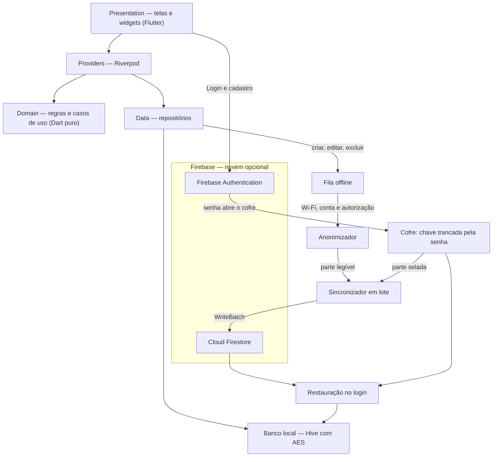

# Justificativas

Este documento foi escrito na Unidade I e atualizado na Unidade II para acompanhar o aplicativo construído. As principais mudanças:

- As metas de redução (RF15) entraram nesta versão.
- O banco local passou a ser o Hive, com criptografia AES, no lugar do SQLite.
- O Modo Camuflagem ganhou criptografia do banco e código secreto.
- A sincronização passou a ser feita em lote, com anonimização.
- Os dados voltam sozinhos ao entrar na conta em outro aparelho, com os valores exatos criptografados pela senha.
- O Início mostra um medidor de saúde do fígado.
- O Relatório ganhou o dashboard de exames, o modo consulta e o PDF.

Os detalhes técnicos estão em [`arquitetura_hepatocheck.md`](arquitetura_hepatocheck.md) e os requisitos novos em [`requisitos.md`](requisitos.md).

## Contexto das decisões

As decisões de interface e arquitetura do HepatoCheck partem de três fatos do estudo de caso: o público tem entre 30 e 60 anos, o consumo de álcool é um dado sensível e o app será usado em casa, no bar e no consultório.

A persona prioritária é **Ricardo**, que baixou o app por indicação médica, tem pouca paciência com aplicativos complexos e medo de que outras pessoas vejam quanto ele bebe. **Marisa**, a segunda persona, é engajada e quer gráficos e dados organizados para levar ao hepatologista. As escolhas abaixo foram feitas para atender Ricardo primeiro, sem perder o que Marisa precisa.

## Escolha das cores

O HepatoCheck usa **tema escuro** com **verde oliva** como cor de marca. O tema escuro reduz o brilho da tela em bares e ambientes com pouca luz, torna o uso mais discreto perto de outras pessoas e cansa menos a vista na leitura de gráficos em casa.

O verde oliva remete à saúde sem o tom frio do azul hospitalar e reforça a personalidade séria, objetiva e confiável definida no estudo de caso. Ele aparece com moderação: no botão de ação principal, no item ativo da navegação e no elemento selecionado. Assim, o usuário encontra rapidamente onde tocar.

A classificação de risco segue o **padrão de semáforo**, com verde, amarelo e vermelho, que qualquer adulto entende sem explicação. Nos selos de classificação, essas cores aparecem sempre com o nome da faixa, para não serem confundidas com outros usos: o vermelho também marca ações que apagam dados, como excluir e sair, e o verde indica melhora no histórico de exames. Em risco alto, está previsto um filtro amarelado que lembra a icterícia, sinal físico associado à doença hepática, para tornar perceptível um problema que costuma ser silencioso.

O contraste foi pensado para atender ao **nível AA da WCAG**: textos principais em tom claro sobre o fundo escuro e textos secundários em cinza esverdeado, com mínimo de **4,5:1** para texto comum.

## Tipografia

A fonte adotada é a **Inter**, desenhada especificamente para telas, com letras abertas e boa leitura em tamanhos pequenos. Ela é incorporada ao app e aparece igual no Android e no iOS, o que mantém a identidade visual em qualquer aparelho.

A hierarquia tem quatro níveis:

- **Título da tela**, maior e em negrito, mostra ao usuário onde ele está.
- **Títulos de seção**, menores e em caixa alta, separam blocos como Histórico e Privacidade.
- **Texto de apoio**, em tom secundário, explica campos e resultados sem competir com a informação principal.
- **Números de destaque**, como o valor do FIB-4 e a quantidade de drinks, têm o maior peso visual do cartão, porque são o que o usuário procura primeiro.

Para garantir a legibilidade, os textos são curtos e diretos, e os termos clínicos aparecem com o nome popular ao lado, como AST (TGO) e ALT (TGP). Isso atende à necessidade de Ricardo de entender o próprio risco sem estudar termos médicos.

## Organização das informações

Cada tela principal responde a uma única pergunta do usuário. O limite de quatro telas do RNF10 valia para o protótipo da Unidade I. Na Unidade II, o app ganhou telas por causa das novas funcionalidades, mas mantém a navegação principal em cinco abas e as ações principais em até três interações (RNF11).

| Tela | Pergunta que responde | Ordem das informações |
| --- | --- | --- |
| Início | Como está meu fígado? | Cartão de risco com o medidor de saúde do fígado de 0 a 100%, consumo das últimas 4 semanas, gráfico da evolução do risco e botão de registro rápido |
| Drinks | Quanto eu bebi? | Tipo de bebida, volume e teor alcoólico, data e hora, quantidade, conversão em drinque padrão e histórico com opção de editar e excluir cada registro |
| Exames | Qual é o meu resultado? | Formulário do exame com a nota de que o FIB-4 é validado entre 35 e 65 anos (RF02), resultado com a faixa de risco e a data do exame, e histórico com a evolução |
| Relatório | Como estou evoluindo? | Filtro de semana ou mês, risco atual, dashboard dos exames, cartões de resumo comparados com o período anterior, consumo por dia e por tipo, progresso das metas, modo consulta e exportação em PDF |

O fluxo visual segue sempre a mesma ordem, de cima para baixo: primeiro o resultado ou a ação principal, depois os detalhes e por último o histórico. Assim, Ricardo resolve o que precisa sem rolar a tela, e Marisa encontra a evolução completa logo abaixo.

Na tela Início, o medidor de saúde do fígado cumpre o papel do gráfico "vida do fígado" do RF07. Ele vai de 0 a 100% e muda de cor conforme a classificação de risco, que é atualizada a cada exame e registro de consumo. No protótipo da Unidade I esse papel era de uma silhueta do corpo. O medidor foi escolhido por mostrar um número e uma cor de leitura imediata. A tela deixa claro que ele é um indicador educativo, não um resultado clínico (RNF17).

O estudo de caso previa a orientação sobre quando procurar o médico como uma das quatro telas principais. No protótipo, ela passou a ser uma sobreposição aberta a partir do selo de risco do Início e do cartão de risco do Relatório, para aparecer exatamente quando o usuário vê o próprio resultado, sem precisar navegar. A orientação continua sendo uma função essencial e apenas mudou de formato. A vaga de tela principal passou para o Relatório, que reúne a visualização de indicadores e o modo consulta.

Login, cadastro, recuperação de senha, o aviso da senha e a política de privacidade são telas de apoio, acessadas apenas quando necessário. O Perfil reúne a conta, as metas, as notificações e lembretes, o Modo Camuflagem, a sincronização e a opção de apagar todos os dados locais.

As metas de redução (RF15) entraram nesta versão, porque a Unidade II passou a exigi-las. A tela Metas permite criar, acompanhar, editar e excluir metas, como o limite de drinques por semana. O Relatório mostra o progresso de cada meta no período. Quando o consumo da semana passa do limite definido pelo usuário, a classificação de risco sobe um nível, para que a meta tenha efeito real no resultado.

O **modo consulta** (RF12) abre a partir de um botão no Relatório, em tela cheia. Ele reúne em uma única tela o que o profissional de saúde precisa ler numa consulta curta:

- a classificação de risco;
- o FIB-4 atual, com os valores do último exame;
- a média de drinques padrão por semana e os dias sem álcool dos últimos 28 dias;
- a evolução dos três últimos exames.

A tela não depende do período escolhido no Relatório, para que o resumo seja sempre o mesmo, e tem um botão grande para sair. Ela atende ao contexto de uso "durante a consulta médica" do estudo de caso sem obrigar o usuário a gerar e enviar um arquivo.

## Navegação

A navegação principal é uma barra inferior fixa com cinco itens: Início, Relatório, Drinks, Exames e Perfil.

Ela fica ao alcance do polegar, é um padrão conhecido tanto no Android quanto no iOS e mostra ícone e nome juntos, para que ninguém precise adivinhar o que cada ícone significa. O item ativo aparece em verde oliva e indica onde o usuário está.

O registro rápido de bebida é o fluxo mais importante, porque acontece no bar, em pé e com pouca atenção. Ele cabe em três toques, conforme o RF05 e o RNF11:

1. Tocar no botão + da tela Início.
2. Escolher o tipo de bebida: cerveja, destilado ou vinho.
3. Tocar em Adicionar.

A quantidade começa em 1, e a data e a hora são preenchidas com o momento atual. Quem precisa registrar outra quantidade ou outro dia usa a aba Drinks, que tem todos os campos.

Ao escolher o tipo, uma linha abaixo dos seletores mostra a conversão em drinque padrão, por exemplo **"1 lata de cerveja = 1 drinque padrão"**. Assim, a conversão aparece antes da confirmação do registro, como pede o RF04, sem acrescentar nenhum toque.

A orientação sobre quando procurar o médico abre como uma sobreposição ao tocar no selo de risco do Início ou no cartão de risco do Relatório, sem tirar o usuário da tela em que ele está. Todas as telas, exceto o Início, têm a seta de voltar no canto superior esquerdo, que leva sempre à tela anterior.

## Componentes

A interface usa componentes do Material Design, que o Flutter oferece prontos e que funcionam da mesma forma no Android e no iOS.

| Componente | Onde aparece | Por que foi escolhido |
|---|---|---|
| Barra de navegação inferior em pílula | Telas principais | Acesso direto às quatro funções centrais e ao perfil |
| Botão flutuante + | Início | Atalho para o registro rápido, sempre no mesmo lugar |
| Cartões | Início, Exames, Relatório e Perfil | Agrupam uma informação por bloco e facilitam a leitura rápida |
| Seletores de tipo com ícone | Registro de drinks | O ícone é reconhecido mais rápido que uma lista, e o tipo escolhido ganha borda verde |
| Contador com botões de menos e mais | Drinks | Ajusta a quantidade sem abrir o teclado |
| Campos de data e hora com seletor | Drinks e Exames | Evitam erros de digitação |
| Campos de texto com rótulo | Login, Cadastro e Exames | O nome do campo continua visível depois de preenchido, e notas curtas abaixo dos campos orientam o preenchimento, como a faixa de idade validada do FIB-4 e o valor de referência das plaquetas |
| Selos de classificação | Início, Exames e Relatório | Mostram o risco com cor, ícone e texto |
| Medidor circular | Início | Mostra a saúde do fígado de 0 a 100% na cor do risco |
| Gráficos de barras e de linha | Início e Relatório | Mostram o consumo por dia, a evolução do risco e a evolução do FIB-4, AST, ALT e plaquetas, com as faixas de risco ao fundo |
| Interruptores | Perfil, notificações e consentimento | Ligam e desligam camuflagem, lembretes e a autorização da sincronização |
| Tela em tela cheia | Modo consulta | Mostra o resumo para o profissional de saúde sem a barra de navegação, para a leitura ficar limpa |
| Teclado de calculadora | Modo Camuflagem | Disfarça o diário com uma calculadora que funciona de verdade |
| Diálogo de confirmação | Excluir registros, apagar dados e compartilhar o PDF | Evita a perda de dados e o envio do resumo sem querer |
| Controle segmentado | Relatório e histórico de Drinks | Troca o período ou a ordenação com um toque |
| Sobreposição | Registro rápido e orientação médica | Mostra um conteúdo pontual sem trocar de tela |

## Acessibilidade

O estudo de caso pede leitura rápida, contraste adequado e elementos visuais simples, e lembra que parte do público tem dificuldade com tecnologia. O RNF02 transforma isso em requisito. As decisões seguem as diretrizes WCAG 2.1 no nível AA e as recomendações de acessibilidade do Material Design:

- **Contraste:** texto claro sobre fundo escuro, com mínimo de 4,5:1 para texto comum.
- **Cor nunca sozinha:** a classificação de risco sempre traz cor, ícone e nome da faixa, para que pessoas com daltonismo também entendam o resultado.
- **Áreas de toque:** botões e itens tocáveis com pelo menos 48 dp, o que facilita o uso em pé no bar e por quem tem menos precisão nos dedos.
- **Rótulos visíveis:** todo campo tem o nome acima dele, que continua visível depois de preenchido.
- **Linguagem simples:** termos clínicos explicados e orientações em frases curtas.
- **Poucas etapas:** as funções principais em até três interações (RNF11) reduzem o esforço de quem tem pouca familiaridade com aplicativos.
- **Leitor de tela e tamanho de fonte:** os componentes recebem descrições para o TalkBack, no Android, e para o VoiceOver, no iOS, e respeitam o tamanho de fonte escolhido nas configurações do aparelho.

## Decisões relacionadas ao contexto de uso

O mesmo aplicativo precisa funcionar em situações muito diferentes, por isso cada condição do estudo de caso gerou uma decisão concreta.

| Contexto ou condição                    | Decisão                                                                                                   |
| --------------------------------------- | --------------------------------------------------------------------------------------------------------- |
| No bar, em pé e com distrações          | Registro rápido em três toques, botões grandes e tema escuro, que chama menos atenção                     |
| Pessoas próximas vendo o celular        | Modo Camuflagem, que troca o app na hora por uma calculadora funcional. O diário só volta com o código secreto, guardado apenas como hash. Ao sair do app, ele volta para a calculadora e fica oculto na tela de apps recentes. Ao ativar, todo o banco local passa a ser criptografado. As notificações ficam com texto neutro. O modo convidado continua funcionando sem cadastro |
| Sem internet                            | Todos os dados são gravados no aparelho, criptografados com AES, e o app funciona 100% offline             |
| Rede móvel ou pública                   | Sincronização apenas via Wi-Fi, com conta e autorização explícita, que pode ser revogada. Os dados são anonimizados antes do envio e enviados em lote, e os valores exatos vão criptografados com a senha da pessoa |
| Em casa, com mais tempo                 | Relatório com gráficos e histórico para análise com calma                                                 |
| Durante a consulta médica               | Modo consulta com os principais indicadores e exportação do resumo em PDF, com confirmação antes de compartilhar |
| Preocupação ao ver o resultado          | Classificação objetiva em três cores e orientação clara sobre quando procurar o médico, sem tom alarmista |
| Pouco conhecimento sobre dose de álcool | Conversão de cada bebida em drinque padrão                                                                |

Nas telas de resultado, como Exames, Relatório, modo consulta, orientação médica e PDF, o app reforça que é uma ferramenta de triagem e não substitui o diagnóstico médico, conforme o RNF17.

## Arquitetura do sistema

O HepatoCheck utiliza uma arquitetura **offline first**: os registros e as funcionalidades principais ficam disponíveis no aparelho, mesmo sem internet.

A nuvem é opcional e serve como cópia de segurança. Os registros só são enviados quando há **conta, autorização do usuário e conexão Wi-Fi**.

Na Unidade I, o banco local previsto era o SQLite. Na Unidade II, ele foi trocado pelo **Hive** (`hive_ce`), que já traz criptografia AES-256 sem biblioteca extra. Essa criptografia era uma exigência para os registros locais e para o Modo Camuflagem. O código foi organizado em três camadas, com o estado gerenciado pelo **Riverpod**.

### Componentes

| Componente | Responsabilidade |
|---|---|
| **Presentation** | Telas Início, Relatório, Drinks, Exames, Perfil, Metas, modo consulta, calculadora da camuflagem, consentimento e status da sincronização. Os gráficos usam a biblioteca `fl_chart`, e o resumo em PDF usa `pdf` e `printing`. |
| **Providers (Riverpod)** | Ligam as telas às regras e aos repositórios e atualizam a interface quando um exame, um registro ou uma meta muda, e também na virada do dia. |
| **Domain** | Regras puras, sem Flutter nem Firebase: cálculo e validação do FIB-4, classificação de risco com a meta semanal, conversão em drinque padrão, relatórios semanais e mensais, metas, medidor do fígado, resumo do modo consulta e mensagens educativas. Por isso essas regras são testadas sem abrir o app. |
| **Data — banco local Hive** | Guarda diário, exames, metas, preferências, fila de sincronização e log de alterações em caixas criptografadas com AES-256. A chave fica no armazenamento seguro do aparelho (`flutter_secure_storage`). Funciona sem internet, inclusive no modo convidado. |
| **Log de alterações** | Registra cada criação, edição e exclusão do diário apenas com o momento, o ID e um hash SHA-256 encadeado, sem guardar o conteúdo (RF24). |
| **Fila offline e sincronizador** | Cada alteração vira um item na fila. Com Wi-Fi, conta e autorização, os itens são anonimizados e enviados em lotes de até 20 com `WriteBatch`, que grava o lote inteiro ou nada. Se um lote falha, só os itens dele ficam marcados com o erro e os outros lotes seguem. A tela de sincronização mostra pendentes e falhas e tem o botão "Tentar de novo". |
| **Firebase Authentication** | Gerencia login, cadastro e recuperação de senha. A conta é opcional e só é necessária para a sincronização e para recuperar os dados em outro aparelho. |
| **Cofre da chave** | Uma chave aleatória criptografa os valores exatos (AES-GCM 256, bibliotecas `cryptography` e `cryptography_flutter`). Essa chave vai para a nuvem trancada pela senha (PBKDF2) e fica no armazenamento seguro do aparelho. |
| **Restauração** | Ao entrar na conta, baixa os registros, abre a parte selada com a chave e grava no aparelho, juntando com o que já existe pela versão mais recente. |
| **Cloud Firestore** | Armazena a cópia dos registros autorizados: uma parte legível anonimizada e uma parte selada com os valores exatos. As regras de segurança permitem que cada usuário leia e grave apenas os próprios documentos, e exigem a parte selada. |

### Fluxo de funcionamento

1. O usuário interage com as telas do aplicativo.
2. Os providers do Riverpod chamam as regras do domínio e os repositórios.
3. Os registros são lidos e gravados no Hive, sempre criptografados.
4. Cada alteração entra na fila offline.
5. Ao abrir o app ou ao conectar no Wi-Fi, o sincronizador verifica a conta e a autorização do usuário.
6. Quando as condições são atendidas, os registros são anonimizados, selados com a chave e enviados em lote ao Firestore. Em rede móvel, nada é enviado.
7. Ao entrar na conta em outro aparelho ou depois de reinstalar o app, a senha abre a chave e os registros voltam automaticamente para o aparelho.

### Restauração com a chave trancada pela senha

A professora pediu que os dados pudessem ser recuperados ao trocar de aparelho, ao reinstalar o app e ao entrar na conta em outros dispositivos. A cópia anonimizada sozinha não permite isso, porque não guarda a idade exata, que o FIB-4 precisa, nem o horário dos registros. O grupo avaliou duas saídas:

| Opção | Como seria | Por que foi ou não escolhida |
| --- | --- | --- |
| Enviar os valores exatos abertos | A nuvem guardaria idade e horários exatos, só sem nome e e-mail | Mais simples, mas quem administra o Firebase poderia ler a idade exata e os horários de consumo de álcool |
| **Valores exatos criptografados com a senha (escolhida)** | A parte legível continua anonimizada; os valores exatos vão numa parte selada que só a senha da pessoa abre | Mantém a anonimização para quem olhar a nuvem, inclusive a equipe, e permite a restauração completa |

A consequência da escolha é que, se a pessoa esquecer a senha e usar a recuperação, a cópia antiga não pode ser aberta. Para isso não pegar ninguém de surpresa, o aplicativo mostra um aviso ao criar a conta e antes de recuperar a senha, com "Entendi" obrigatório. Os dados que ainda estão no aparelho são enviados de novo com a chave nova; o histórico só se perde se a pessoa perder a senha e o aparelho ao mesmo tempo.
